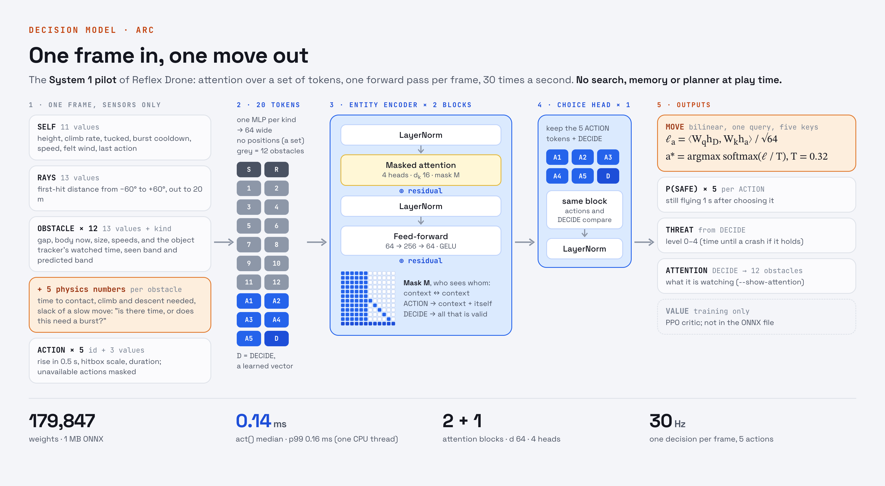
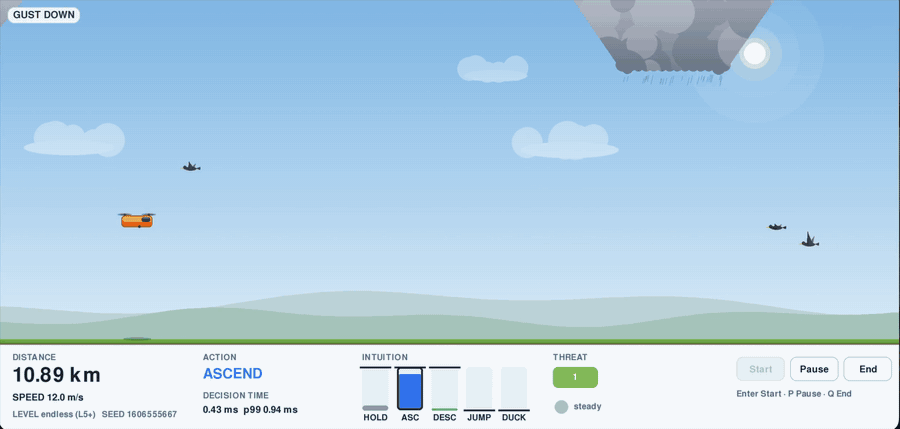
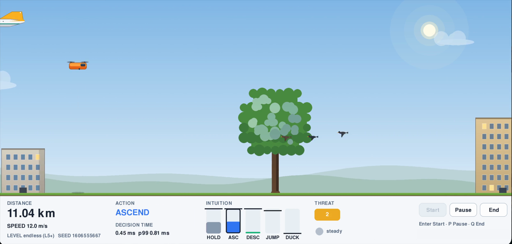
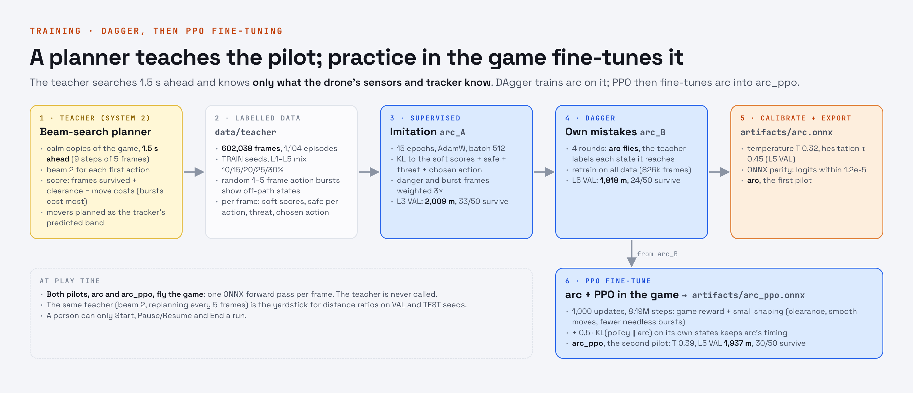

<h1 align="center">Project J'AI 2 · Reflex Drone</h1>
<h3 align="center">arc and arc_ppo: System 1 pilots that fly a drone by reflex, one frame in and one move out, 30 times a second</h3>

<p align="center">
  <a href="https://medium.com/@jaiganesan"></a>
  <a href="https://www.linkedin.com/in/jaiganesan-n/"></a>
</p>
<p align="center">
  
  
  
  
  
</p>

<p align="center">
  
</p>

<p align="center">
  <a href="#watch-the-full-run"></a>
</p>

<sub>arc flying the endless level on its own at 10.9–11.0 km (L5+, 12 m/s), through gusts, a speed surge, a downdraft, storm clouds, birds and a plane. The full 70-second run is <a href="#watch-the-full-run">below</a>.</sub>

| **179,847** | **0.14 ms** | **0.89 · 0.94** | **5.1 · 6.8 km** |
| :---: | :---: | :---: | :---: |
| weights per pilot, in a 1 MB ONNX file | per decision on one CPU thread (p99 0.16 ms) | L5 TEST distance ratio against the planner (arc · arc_ppo) | median endless run before the first crash (arc · arc_ppo) |

DroneDash is a Chrome-Dino-style side-scroller in which a drone flies itself. Each frame, it reads its sensors and picks one of five actions: HOLD, ASCEND, DESCEND, JUMP or DUCK. The pilot is a 179,847-weight attention network, trained with two methods:

- **arc** is trained with **DAgger**. It learns by copying a planner that searches 1.5 s ahead, then flies on its own while the planner labels every state it reaches.
- **arc_ppo** is arc **fine-tuned with PPO** in the game itself: the same network with new weights.

Both are trained pilots, and **both fly in the game**: `--agent` picks which one. At play time only the pilot runs, never the planner. A person can Start, Pause/Resume or End a run, and nothing else. Everything runs on one MacBook Air: the game and pilot on the CPU, training on Apple MPS, with packages from [uv](https://docs.astral.sh/uv/).

> [!NOTE]
> **Objective.** Train a Type 1 decision model: fast, automatic and pattern-driven, in the sense of Kahneman's System 1. The model flies a drone through a side-scroller. Each frame, it observes the world and picks one of 5 actions with minimal latency. The goal is to survive as long as possible and fly as far as possible, using learned reflexes rather than planning.

| Contents | |
| --- | --- |
| [1. What is the project?](#1-what-is-the-project) | The scenario rules, the game, the snapshot |
| [2. Architecture](#2-architecture) | The decision model, its inputs and outputs, weight counts, and training (DAgger, then PPO) |
| [3. Simple maths](#3-simple-maths) | Physics, tokens, attention, the decision, the teacher, the losses, the metric |
| [4. Results and discussion](#4-results-and-discussion) | VAL and TEST for both pilots, how they fly, endless runs, the gates, arc vs arc_ppo |
| [5. How to use this repo](#5-how-to-use-this-repo) | Install, play, train, evaluate, test, use from code, layout |

---

## 1. What is the project?

A planner can fly this game well, but it thinks: it simulates hundreds of futures for every decision. **Reflex Drone asks whether a small network can learn that skill as a reflex.** Can a single forward pass, with no search, no memory and no look-ahead, fly as far as the planner that taught it?

### The scenario rules

| Rule | How the code meets it |
| --- | --- |
| A person can only Start, Pause/Resume and End | `app/controls.py` has no flying keys. The agent, level and seed are set by flags at launch (`tests/app/test_controls.py`). |
| The drone decides every frame, on its own | One decision per simulation step at 30 Hz. A masked action becomes HOLD. |
| System 1 only at play time | One ONNX forward pass per frame. `app/` and `agents/` never import the planner or the simulator. |
| It sees only its sensors | The observation in `drone_env/sensors.py` is all it gets. The object tracker never reads a bird's hidden path settings (`tests/env/test_tracker.py`). |
| Obstacles are random | Every Start uses a fresh seed. Evaluation uses fixed TRAIN / VAL / TEST / STRESS seed lists (`drone_env/seeds.py`). |
| Pause freezes everything | No decisions while paused, and paused time is left out of every timer. |

### The game

<p align="center"></p>

<sub>A frame from the recording. arc has chosen ASCEND at threat level 2 as birds cross in front of a tree. The HUD shows its decision time (0.45 ms here, while the game is drawing), the probability of each action ("intuition") and the threat level.</sub>

Real-life obstacles for a drone flying along a road: buildings, trees, street lights, kites, storm clouds, birds, other drones and hot-air balloons, planes (high up) and downdrafts. Gusts, speed surges and fog arrive with no warning. The drone only *feels* a gust once it hits.

| Level | Speed | Obstacles |
| --- | --- | --- |
| L1 | 10 m/s | sparse, no combos |
| L2–L5 | 12 m/s | each level denser, with more birds and drones, more combos and more interruptions |
| endless (default) | 10 → 12 m/s | starts at L1 and moves up a level every 1.75 km; past 7 km ("L5+") the obstacles keep getting denser |
| stress (test only) | 14.4 m/s | twice the interruptions, with gust, fog and surge at once |

| Action | Effect | Use |
| --- | --- | --- |
| HOLD | target climb rate 0 (hover) | the default |
| ASCEND / DESCEND | target ±3 m/s | the normal moves |
| JUMP / DUCK | ±6 m/s for 0.3 s; DUCK also tucks the hitbox to 60%; a shared 1 s cooldown | bursts, for sudden obstacles at speed |

- **Sensors reach 20 m** (8 m in fog): 13 rays, plus up to 12 nearby obstacles.
- **Birds and drones are not fully predictable.** Their rhythm wanders, and 30% of birds dive or pop up now and then.
- **Tracker.** Like a real drone's sensing software, an object tracker fits each bird or drone from its sightings and predicts a band it can be in while the drone passes. The band is wide at first sight and narrows as the tracker learns the rhythm.

### Watch the full run


https://github.com/user-attachments/assets/fa877c7f-902b-4164-b366-6d9229c38149


arc flying the endless level on its own for 70 s, uncut, from 10.46 to 11.28 km at 12 m/s. Nobody touches the controls.

<!-- VIDEO: on github.com, edit this file and drag arc_model_demo3.mp4 onto the empty line below this comment.
     GitHub uploads it and writes a https://github.com/user-attachments/assets/... link there, which plays inline.
     A video stored in the repository itself does not play in a README. -->


---

## 2. Architecture

### 2.1 The decision model

arc is shown in the figure at the top. arc_ppo has the same network and differs only in its weights. One frame becomes a **set of 20 tokens**, each 64 wide, with no position embeddings, because obstacles have no natural order:

| Token | Input | Encoder |
| --- | --- | --- |
| SELF × 1 | 11 values: height, climb rate, tucked, burst cooldown, speed, felt wind, last action | MLP 11 → 64 → 64 |
| RAYS × 1 | 13 first-hit distances, −60° to +60° | MLP 13 → 64 → 64 |
| OBSTACLE × 12 | 13 values (gap, body now, size, speeds, and the tracker's watched time, seen band and predicted band), plus 5 physics numbers computed inside the network, plus a kind embedding | MLP 18 → 64 → 64, + embedding |
| ACTION × 5 | an id, plus 3 values: height gained in 0.5 s, hitbox scale, duration | embedding + MLP 3 → 64 → 64 |
| DECIDE × 1 | nothing: a learned vector that asks the question | — |

The 5 physics numbers per obstacle (time to contact, the climb and descent needed, and the slack of a slow move started now) answer one question directly: **is there time for a slow move, or does this need a burst?**

- **Entity encoder, 2 blocks.** Pre-norm transformer blocks (4 heads, feed-forward 64 → 256 → 64, GELU) with a mask. The context tokens see each other. Each ACTION sees the context and itself, never another action. DECIDE sees everything that is valid.
- **Choice head, 1 block.** The same block over only the 5 ACTION tokens and DECIDE, so the options can be compared.
- **Outputs:**
  - **MOVE:** bilinear logits DECIDE · ACTION, with unavailable actions set to −∞.
  - **P(safe)** for each action: still flying 1 s after choosing it.
  - **THREAT** 0–4.
  - **DECIDE's attention** over the 12 obstacles (`--show-attention` outlines the one it watches).
  - A **value** head, used in PPO training only.

Code: `models/arc.py`. Settings: `configs/train/arc.yaml`.

| Part | Weights |
| --- | ---: |
| Token encoders (SELF, RAYS, OBSTACLE + kind embedding, ACTION, DECIDE) | 20,992 |
| Entity encoder, 2 blocks × 49,984 | 99,968 |
| Choice head, 1 block | 49,984 |
| Read-out (LayerNorm, W<sub>q</sub>, W<sub>k</sub>, safe, threat) | 8,838 |
| Value head (training only, not exported) | 65 |
| **Total** | **179,847** (179,782 in `artifacts/arc.onnx`) |

### 2.2 Training: DAgger, then PPO



Two training methods, one after the other. **DAgger** trains arc from the planner (System 2 teaches System 1, steps 1–5). **PPO** then fine-tunes arc by practice in the game, which gives arc_ppo (step 6). Both pilots are calibrated, exported to ONNX and flown in the game.

1. **Teacher** (`teacher/planner.py`, `configs/train/teacher.yaml`). A beam search on calm copies of the game: 9 macro steps of 5 frames (1.5 s), with a beam of 2 for each first action.
   - It knows only what the pilot knows: the 20 m sensor range, and movers as the tracker's predicted band.
   - A student copies only what it can see. When earlier teachers planned with information the pilot lacked, such as a bird's exact path, the pilot held where the teacher moved.
2. **Data** (`data/collect.py`). 602,038 labelled frames on TRAIN seeds.
   - Random 1–5 frame action bursts show the teacher states off its own path.
   - Labels for each frame: soft scores, safe per action, threat, and the chosen action.
3. **Supervised** `arc_A` (`train/supervised.py`). 15 epochs on Apple MPS, about 8 minutes.
4. **DAgger** `arc_B` (`data/dagger.py`). 4 rounds: arc flies, the teacher labels every state it reaches, and arc retrains on all the data so far (826k frames).
5. **Calibrate and export arc** (`train/calibrate.py`, `train/export_onnx.py`) to `artifacts/arc.onnx`.
   - Temperature T = 0.32. Hesitation threshold τ = 0.45, shown on the HUD and never handed off.
   - ONNX logits are within 1.2e-5 of PyTorch.
6. **PPO fine-tuning: arc_ppo** (`train/ppo.py`, `scripts/train_arc_ppo.sh`). Starting from arc's weights, 1,000 updates of practice in the real game, anchored to arc by a KL term.
   - The best update (560) is calibrated (T = 0.39, τ = 0.45) and exported to `artifacts/arc_ppo.onnx`.
   - ONNX logits are within 1.1e-5 of PyTorch.

| Setting | Supervised `arc_A` | DAgger `arc_B` | PPO `arc_ppo` |
| --- | --- | --- | --- |
| Start | random init | `arc_A` | `arc_B` (arc) |
| Data | 602k teacher frames | + 4 × 60k frames flown by arc | 8.19M game steps (8 games × 1,024 per update) |
| Optimizer | AdamW, lr 3e-4, cosine, wd 0.01, batch 512 | same, 3 epochs per round | lr 1e-4, clip 0.1, γ 0.99, λ 0.95 |
| Level mix (L1–L5) | 10/15/20/25/30% | 5/10/20/30/35% | 10/15/20/25/30% |
| Time on the Mac | 8 min (after 12 min of data) | 20 min | about 3 h |

---

## 3. Simple maths

**Physics** (30 Hz, Δt = 1/30 s). Each action sets a target climb rate $v^\ast$ (0, ±3 or ±6 m/s). The drone's vertical speed follows it, with wind added:

$$
a = \mathrm{clip}\big(8\,(v^\ast - v_y),\ -12,\ 12\big), \qquad v_y \leftarrow v_y + (a + a_{\text{wind}})\,\Delta t, \qquad y \leftarrow y + v_y\,\Delta t
$$

**Tokens.** Every input becomes a 64-number token through a small MLP. For an obstacle with gap $g$, closing speed $v_c$ and climb needed $\Delta y_\uparrow$, the physics numbers are:

$$
h = W_2\,\mathrm{GELU}(W_1 x + b_1) + b_2, \qquad t_c = \min\!\left(\frac{g}{v_c},\ 3\,\text{s}\right), \qquad \text{slack}_\uparrow = 3\,t_c - 0.375 - \Delta y_\uparrow
$$

Here, 0.375 m is the height lost while ASCEND speeds up to 3 m/s. Descent works the same way.

**Masked attention and one block** (4 heads, $d_k = 16$; $M_{ij} = 0$ where token $i$ may see token $j$, else $-\infty$):

$$
\mathrm{Attn}(Q,K,V) = \mathrm{softmax}\!\left(\frac{QK^\top}{\sqrt{d_k}} + M\right)V, \qquad x \leftarrow x + \mathrm{Attn}(\mathrm{LN}\,x), \qquad x \leftarrow x + \mathrm{FFN}(\mathrm{LN}\,x)
$$

**The decision.** One query (DECIDE) against five keys (the actions):

$$
\ell_a = \frac{(W_q h_D)^\top (W_k h_a)}{\sqrt{64}}, \qquad p = \mathrm{softmax}(\ell / T), \qquad a^\ast = \arg\max_a p_a, \qquad \text{hesitating if } \max_a p_a < \tau
$$

$T$ fits the teacher's choices on L5 VAL (it minimises their NLL). $\tau$ is the confidence below which arc agrees with the teacher less than 70% of the time.

**The teacher's score.** Each plan is scored as below; the score $s_a$ of a first action is the best score of the plans that start with it:

$$
S = F_{\text{survived}} + 0.5\,\bar c - 0.05\,n_{\text{slow}} - n_{\text{burst}}\left(1 + 3\,\mathrm{clip}\!\left(\frac{16 - v}{8}, 0, 1\right)\right), \qquad q = \mathrm{softmax}(s / 2)
$$

- $F$: frames survived, out of 45.
- $\bar c$: mean clearance, capped at 2 m.
- $n$: the number of slow (ASCEND/DESCEND) and burst (JUMP/DUCK) macro steps.
- A burst costs 2.5 at 12 m/s and 3.25 at 10 m/s, so the teacher bursts only when a slow move can't get through.

**The supervised loss** (masked actions excluded):

$$
\mathcal{L} = \mathrm{KL}(q \,\Vert\, p) + 0.5\sum_a \mathrm{BCE}(\text{safe}_a) + 0.25\,\mathrm{CE}(\text{threat}) + 0.5\,\mathrm{CE}(a_{\text{teacher}})
$$

**DAgger.** In round $k$, the pilot flies, and the teacher's action is used with probability $\beta_k$ = 0.5, 0.25, 0, 0. Every state reached is labelled by the teacher and added to the data.

**PPO with an anchor.** The actor is sampled at arc's temperature. Without the KL anchor, earlier PPO runs started their moves about 0.5 s later than the pilot they started from:

$$
\mathcal{L}_{\text{PPO}} = -\mathcal{L}^{\text{clip}}_{0.1} + 0.5\,\mathcal{L}^{V} - 0.005\,H + 0.5\,\mathrm{KL}\big(\pi_\theta \,\Vert\, \pi_{\text{arc}}\big) + 0.5\,\mathcal{L}_{\text{teacher}}
$$

**The metric.** Every evaluation episode is capped at 6,000 frames (200 s). The reference is the teacher itself, with beam 2, replanning every 5 frames:

$$
\text{distance ratio} = \frac{\text{mean distance of the pilot}}{\text{mean distance of the reference planner}}\ \text{(same seeds, same level)}, \qquad \text{stress drop} = 1 - \frac{\text{ratio(stress)}}{\text{ratio(L5 TEST)}}
$$

---

## 4. Results and discussion

### 4.1 Distance and survival

Mean distance, and the share of runs that fly the full 200 s. Each run is capped at 6,000 frames: about 2.0 km at L1 and 2.4 km at L2–L5.

| | L1 | L2 | L3 | L4 | L5 | stress |
| --- | --- | --- | --- | --- | --- | --- |
| **arc, TEST** (100 unseen seeds, run once) | 1,947 m · 93% | 2,174 m · 77% | 2,020 m · 65% | 2,070 m · 63% | 1,697 m · 43% | 832 m · 2% |
| **arc_ppo, TEST** (the same seeds, run once) | 1,999 m · 98% | 2,071 m · 73% | 1,996 m · 64% | 2,035 m · 66% | 1,808 m · 51% | 852 m · 3% |
| arc_ppo − arc on TEST, paired, ± 1 se | +52 ± 36 m | −103 ± 51 m | −24 ± 70 m | −35 ± 89 m | +111 ± 102 m | +20 ± 90 m |
| arc, VAL (50 seeds) | 1,922 m · 92% | 2,112 m · 80% | 2,135 m · 76% | 1,881 m · 52% | 1,818 m · 48% | |
| arc_ppo, VAL (same 50 seeds) | 2,012 m · 98% | 2,057 m · 72% | 2,092 m · 72% | 1,866 m · 56% | 1,937 m · 60% | |
| arc_ppo − arc on VAL, paired, ± 1 se | +91 ± 54 m | −55 ± 130 m | −43 ± 92 m | −15 ± 133 m | +120 ± 130 m | |

**The headline result is the L5 TEST distance ratio: 0.89 for arc and 0.94 for arc_ppo**, at an `act()` p99 of 0.16 ms.

- **L5 TEST:** the reference planner flies 1,918 m on the same 100 seeds (57% survive). arc flies 1,697 m and arc_ppo 1,808 m.
- **Stress:** arc's ratio is 0.98 and arc_ppo's 1.00. The planner also struggles there: 851 m, with 3% of runs surviving.
- **L5 VAL:** against the planner's 1,953 m (33 of 50 survive), arc's ratio is 0.93 and arc_ppo's is 0.99.

### 4.2 How they fly

Jai judges a pilot by how it looks in play: it should fly smoothly at a sensible height, mostly HOLD, and use slow moves first. Measured greedily on 8 VAL seeds per level:

| | HOLD | Moves start, median lead | Mean height | JUMP/DUCK per min |
| --- | --- | --- | --- | --- |
| arc, L1 · L3 · L5 · endless | 92 · 84 · 77 · 91% | 1.03 · 1.13 · 1.15 · 1.04 s | 6.6 · 6.1 · 5.8 · 6.5 m | 0.3 · 1.1 · 1.7 · 0.3 |
| arc_ppo, L1 · L3 · L5 · endless | 92 · 84 · 76 · 91% | 1.04 · 1.13 · 1.12 · 0.99 s | 6.6 · 6.1 · 5.8 · 6.5 m | 0.2 · 0.6 · 1.1 · 0.2 |

**Endless** (18 long VAL runs, the same seeds for both):
- **arc:** median 5.1 km, with 39% of runs passing 6 km.
- **arc_ppo:** median 6.8 km, with 72% passing 6 km. It flew farther on 12 of the 18 seeds.

The recording above is arc on another endless seed, still flying at 11.3 km.

### 4.3 The gates

| Gate | Condition | Result |
| --- | --- | --- |
| G1 game | env checks, determinism, Start/Pause/End, rule agent ≥ 300 m on L1 | pass: 249 tests pass |
| G3 first reflexes | `arc_A` ratio ≥ 0.50 on L3 VAL | pass: 2,009 m, 33/50 survive (ratio 1.40 against the planner of that time) |
| G4 corrected | `arc_B` ratio ≥ 0.75 on L5 VAL | pass: 0.93 |
| G5 practised | final pilot's ratio ≥ 0.90 on L5 VAL | pass: arc 0.93, arc_ppo 0.99 |
| G6 final | `act()` p99 < 1 ms; stress drop ≤ 0.20 | pass for both: p99 0.16 ms; stress drop −0.10 for arc (0.98 vs 0.89) and −0.06 for arc_ppo (1.00 vs 0.94) |

Ratios use the current reference: `teacher.yaml`, beam 2, replanning every 5 frames. G2 (the teacher's own gate) was checked in session 3 for the first teacher. It has not been re-run for the v2.3 teacher, which flies the full 200 s on 33 of 50 L5 VAL seeds.

### 4.4 Discussion

- **The reflex is real.** One forward pass of 0.14 ms flies 89% (arc) and 94% (arc_ppo) as far as the teacher's 1.5 s search on L5 TEST. On L1, 93% and 98% of TEST runs fly the full 200 s. Neither pilot calls a planner; the look-ahead is learned.
- **Timing comes from the teacher.** arc starts its moves about 1.0–1.15 s before an obstacle reaches its path, close to the teacher's 1.15–1.25 s, not at the last moment. It holds 77–92% of the time and mostly uses ASCEND and DESCEND.
- **The student copies only what it can see.** Earlier teachers knew things the pilot didn't: a bird's exact path, or obstacles beyond sensor range. Their students held where the teacher moved. The fix was to give both the same view: sensor-limited planning, and an object tracker that both of them use.
- **Where arc fails.**
  - Needless bursts near the ceiling: 13 of the 57 L5 TEST crashes and 22 of the 98 stress crashes hit the ceiling.
  - Climbing into storm clouds while passing a bird.
  - Stress (14.4 m/s, every interruption at once) is far outside its training. Only 2% of stress runs survive.
- **arc vs arc_ppo.**
  - PPO with a KL anchor kept arc's timing and height. It is the first PPO pilot here that did not turn late or cruise near the ceiling.
  - It nearly removed the ceiling crashes: 5 vs 31 on L1–L5 TEST, 4 vs 22 in stress, and 0 vs 15 on VAL. It also cut bursts by a third and flew longer endless runs.
  - It crashes more often into buildings and traffic drones: 34 vs 24 and 11 vs 7 on L1–L5 TEST, and 25 vs 13 and 16 vs 8 in stress.
  - Over L1–L5 TEST, mean distance is a tie (1,982 m each). arc_ppo is ahead on L1 and L5 (L5 ratio 0.94 vs 0.89), behind on L2 (−103 ± 51 m) and level in stress.
  - **Both are finished pilots: both were run once on the same TEST and stress seeds, and both fly in the game.** arc_ppo is the steadier flier on long runs. arc is a little better on L2.

More detail: inputs, network and training are in [reports/arc_model_card.md](reports/arc_model_card.md), and every run is in [reports/run_log.md](reports/run_log.md).

---

## 5. How to use this repo

Needs [uv](https://docs.astral.sh/uv/), which fetches Python 3.11 if you don't have it. Tested on an Apple Silicon MacBook Air.

```bash
uv sync
```

### Play

Both trained pilots fly in the game. Pass either ONNX file to `--agent`:

```bash
uv run python -m app.play --agent onnx-arc:artifacts/arc.onnx                                   # arc (DAgger), endless mode
uv run python -m app.play --agent onnx-arc:artifacts/arc_ppo.onnx                               # arc_ppo (DAgger + PPO), endless mode
uv run python -m app.play --agent onnx-arc:artifacts/arc.onnx --level L5 --seed 42 --show-attention
uv run python -m app.play --agent rule                                                          # hand-written test pilot
```

| Key / button | What it does |
| --- | --- |
| Enter, S, **Start** | Start a run (a fresh random seed unless `--seed` is given) |
| P, Space, **Pause** | Pause / resume. The simulation and the agent freeze. |
| Q, Esc, **End** | End the run (on the summary screen: back to the title) |

Flags are fixed for the whole session:
- `--agent`: `onnx-arc:<path>` (`artifacts/arc.onnx` or `artifacts/arc_ppo.onnx`), `rule` or `random`.
- `--level`: `L1`–`L5`, `endless` (the default) or `stress`.
- `--seed N`, `--log-frames`, `--show-attention`.

Each run writes `runs/play/<time>_seed<seed>.json`, plus a per-frame CSV with `--log-frames`.

> [!IMPORTANT]
> `artifacts/`, `runs/`, `data/*/` and `reports/*.json` are git-ignored, so the trained pilots exist only on the machine that made them. On a fresh clone, run `bash scripts/train_arc.sh` for arc (about 1 h on AC power), then `bash scripts/train_arc_ppo.sh` for arc_ppo (about 2.5 h), or play the `rule` agent.

### Train and evaluate

```bash
bash scripts/smoke_pipeline.sh     # every step at toy size, about 3 min
bash scripts/train_arc.sh          # arc: teacher data -> supervised -> DAgger -> calibrate -> artifacts/arc.onnx -> VAL (about 1 h)
bash scripts/train_arc_ppo.sh      # arc_ppo: PPO fine-tuning of arc -> calibrate -> artifacts/arc_ppo.onnx -> VAL (about 2.5 h on AC)

uv run python -m eval.evaluate --agent onnx-arc:artifacts/arc.onnx --levels L1 L2 L3 L4 L5 --seeds val --out reports/arc_val.json
uv run python -m eval.evaluate --agent planner --levels L5 --seeds val --out reports/planner_val.json      # the reference
uv run python -m eval.latency --agent onnx-arc:artifacts/arc.onnx --calls 10000 --out reports/latency_arc.json
uv run python scripts/calibrate_tracker.py                                                                # after changing bird or drone motion
```

- Run TEST and STRESS (`--seeds test --levels ... stress`) **once** per finished pilot, never to pick settings. arc and arc_ppo have each had their run (`reports/arc_final.json`, `reports/arc_ppo_final.json`).
- On a Mac, train on AC power under `caffeinate -i`. Low Power Mode makes the planner 3–10× slower and inflates latency numbers.
- Settings: `configs/train/teacher.yaml` (the teacher and the reference), `collect.yaml`, `arc.yaml`, `dagger.yaml` and `ppo.yaml`.

### Test

```bash
uv run pytest -q                     # 249 tests, about 1.5 min
uv run python -m drone_env.bench     # simulator speed, one core
uv run python -m app.rule_eval       # rule agent on the 50 L1 VAL seeds
```

### Use it from code

```python
import gymnasium, drone_env
from app.agents_base import load_agent

pilot = load_agent("onnx-arc:artifacts/arc.onnx")             # or "onnx-arc:artifacts/arc_ppo.onnx", "rule", "random"
env = gymnasium.make("DroneDash-v0", level="L3", max_frames=6_000)
obs, info = env.reset(seed=123)
pilot.reset(env.unwrapped.action_descriptors())
done = False
while not done:
    d = pilot.act(obs)                                        # Decision: action, probs, threat, attended, hesitating
    obs, reward, terminated, truncated, info = env.step(d.action)   # 0 HOLD, 1 ASCEND, 2 DESCEND, 3 JUMP, 4 DUCK
    done = terminated or truncated
print(f"{info['distance_m']:.0f} m, crash: {info['crash_cause']}")   # 2454 m, crash: None
```

### Repository layout

```
reflex-drone/
├── drone_env/   the game: constants, sim, generator, events, sensors, tracker, env (Gymnasium), wrappers, render, seeds, bench
├── app/         play (the window), controls (Start/Pause/End), hud, agents_base (rule, random), rule_eval
├── teacher/     planner (System 2 beam search), parallel
├── data/        collect, rollout, dataset, inspect, dagger
├── models/      arc (System 1), mlp (flat baseline), policy
├── train/       supervised, calibrate, ppo, export_onnx, common
├── eval/        evaluate, latency, report, planner_cache
├── agents/      onnx_agents (onnx-arc, onnx-mlp)
├── configs/     game.yaml, levels.yaml, tracker.yaml, train/
├── scripts/     train_arc.sh, train_arc_ppo.sh, smoke_pipeline.sh, calibrate_tracker.py
├── tests/       env/, app/, teacher/, models/, train/
├── reports/     arc_model_card.md, run_log.md (+ git-ignored evaluation JSON)
└── docs/        figures/ (architecture, training pipeline, gameplay; sources in figures/src/)
```

The contract every build session followed (game rules, physics, observation, APIs, gates) is `docs/SPEC.md` (v2.3), in the parent `Project J'AI 2` folder rather than in this repository. The logs of earlier pilots (v19–g22) and a bundle of the earlier git history are in `archive/`, which is git-ignored and kept on the build machine.

---

## Author

**Jaiganesan** · [Medium](https://medium.com/@jaiganesan) · [LinkedIn](https://www.linkedin.com/in/jaiganesan-n/)
